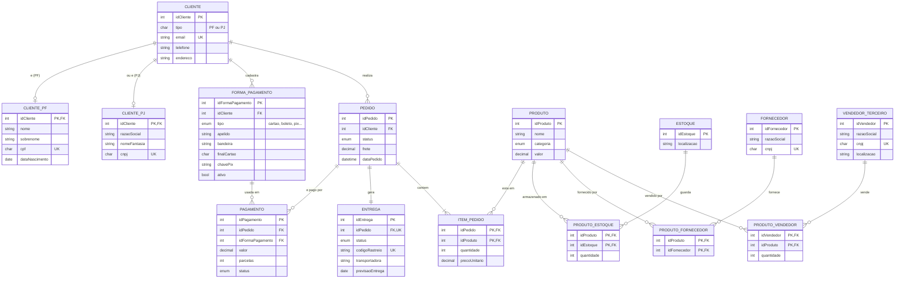

# Projeto Conceitual de Banco de Dados: E-commerce

Desafio de projeto da DIO: **refinar o modelo conceitual de um e-commerce**, partindo do esquema construído durante o curso (clientes, produtos, pedidos, estoque, fornecedores e vendedores terceiros) e acrescentando três pontos novos.

## Objetivo do desafio

| # | Requisito | Como foi resolvido |
|---|-----------|--------------------|
| 1 | **Cliente PJ e PF**: uma conta pode ser PJ ou PF, mas não pode ter as duas informações | Generalização/especialização **disjunta**: `CLIENTE` (supertipo) com `CLIENTE_PF` e `CLIENTE_PJ` (subtipos). O banco impede que o mesmo cliente exista nos dois subtipos. |
| 2 | **Pagamento**: pode ter cadastrado mais de uma forma de pagamento | Entidade `FORMA_PAGAMENTO` (1 cliente : N formas) e entidade associativa `PAGAMENTO` ligando `PEDIDO` a `FORMA_PAGAMENTO` (N:M). Um pedido também pode ser dividido em mais de uma forma. |
| 3 | **Entrega**: possui status e código de rastreio | Entidade `ENTREGA` (1:1 com `PEDIDO`) com atributos `status` e `codigoRastreio`. |

## Modelo conceitual

O diagrama abaixo é renderizado automaticamente pelo GitHub (Mermaid).



## Decisões de modelagem

### 1. Cliente PF ou PJ (exclusivo)

`CLIENTE` guarda os dados comuns (e-mail, telefone, endereço) e o `tipo` da conta. Os dados específicos ficam em `CLIENTE_PF` (CPF, nome, data de nascimento) ou `CLIENTE_PJ` (CNPJ, razão social).

A regra "não pode ter as duas informações" é imposta pelo próprio banco, e não só pela aplicação:

- `CLIENTE` tem `UNIQUE (idCliente, tipo)`.
- Cada subtipo repete a coluna `tipo`, fixa o valor com `CHECK` (`'PF'` ou `'PJ'`) e referencia o par `(idCliente, tipo)` do supertipo.
- Resultado: um cliente marcado como `PF` só consegue linha em `CLIENTE_PF`. Tentar criar a linha em `CLIENTE_PJ` viola a chave estrangeira.

Limitação conhecida: o SQL não obriga que todo cliente tenha uma linha em algum subtipo (participação total). Isso é feito na aplicação, inserindo `CLIENTE` e o subtipo na mesma transação.

### 2. Várias formas de pagamento

- `FORMA_PAGAMENTO` é a "carteira" do cliente: cartão de crédito, cartão de débito, boleto, Pix ou transferência. Só guardamos dados de identificação do cartão (bandeira e 4 últimos dígitos), nunca o número completo ou o CVV.
- `PAGAMENTO` é a entidade associativa entre `PEDIDO` e `FORMA_PAGAMENTO`, com valor, parcelas e status. Assim um pedido pode ser pago com mais de uma forma (por exemplo, cartão + Pix).
- Ambas as chaves estrangeiras de `PAGAMENTO` incluem `idCliente`, o que impede pagar o pedido de um cliente com a forma de pagamento de outro.

### 3. Entrega com status e rastreio

- `ENTREGA` tem relação 1:1 com `PEDIDO` e separa o **status da entrega** do **status do pedido**.
- Status da entrega: `PREPARANDO`, `POSTADO`, `EM_TRANSITO`, `SAIU_PARA_ENTREGA`, `ENTREGUE`, `DEVOLVIDO`.
- O `codigoRastreio` é único e só pode ficar vazio enquanto a entrega está em `PREPARANDO`, porque o código só existe depois da postagem. Entregas `ENTREGUE` exigem `dataEntrega`.

## Estrutura do repositório

```
.
├── README.md
└── sql/
    ├── 01_schema.sql      # criação do banco, tabelas, PKs, FKs e CHECKs
    ├── 02_dados.sql       # dados fictícios para teste
    └── 03_consultas.sql   # consultas de exemplo e testes de integridade
```

## Como executar

Requer **MySQL 8.0.16 ou superior** (versões anteriores aceitam a sintaxe de `CHECK`, mas não a aplicam). Pode ser usado pelo MySQL Workbench ou pela linha de comando:

```bash
mysql -u root -p < sql/01_schema.sql
mysql -u root -p < sql/02_dados.sql
mysql -u root -p < sql/03_consultas.sql
```

O arquivo `03_consultas.sql` termina com quatro comandos comentados que **devem falhar**. Descomente-os para ver as regras de integridade em ação (cliente PF recebendo registro PJ, pagamento com forma de outro cliente, entrega postada sem código de rastreio).
